<p align="center">
  
</p>

<p align="center">
  <a href="https://hafizhmaulanay.vercel.app/"></a>
  <a href="https://www.linkedin.com/in/hafizhmaulanay"></a>
  <a href="https://x.com/fiz_ipan"></a>
  <a href="https://instagram.com/fizipan"></a>
</p>

Hi, I'm Hafizh, or `fizipan` around here. I write software with AI agents. Most of my work runs through coding agents now, so the job has moved from typing code to writing clear specs, setting guardrails and checking what comes back.

**Now playing with:** multi-agent workflows, MCP servers, agent skills, and working out what all those tokens really cost.

💬 Ask me about Claude Code, MCP, and getting useful work out of agents on a real codebase.

## How I work with agents

I treat agents like fast junior devs who never get tired and sometimes make things up. My loop goes like this:

```
spec → plan → agents build → I review → test it in a real browser → ship
```

The review and the browser check are the parts I won't hand over.

<p>
  
  
  
  
</p>

## The journey so far

- **2019:** Started Computer Software Engineering at SMK Negeri 17 Jakarta.
- **2021:** Interned at PT Artoone, building a retail CMS, then joined Art By Code as a Junior Software Engineer: HR, loyalty, booking and marketplace apps.
- **2022:** 1st place at LKS Kota Jakarta Barat and 3rd place at LKS Provinsi DKI Jakarta. Started my IT degree at Universitas Budi Luhur.
- **2023:** Frontend Developer at Kelas Pintar, then Senior Front-End Engineer at Art By Code, leading and mentoring the frontend team.
- **2024:** Software Engineer at Tripatra, on enterprise material and document management systems with Golang, Python, SAP, Kafka and Redis.
- **2025:** Finished my bachelor's degree in Information Technology.
- **2026:** Senior Frontend Developer at PT Rapier Technology International.

## What I work with

<p>
  
</p>

## GitHub stats

<p align="center">
  
</p>

<p align="center">
  
</p>

<p align="center">
  
  
</p>

<sub>Indonesian native, working English. Say hi at hafizhmy26@gmail.com.</sub>
